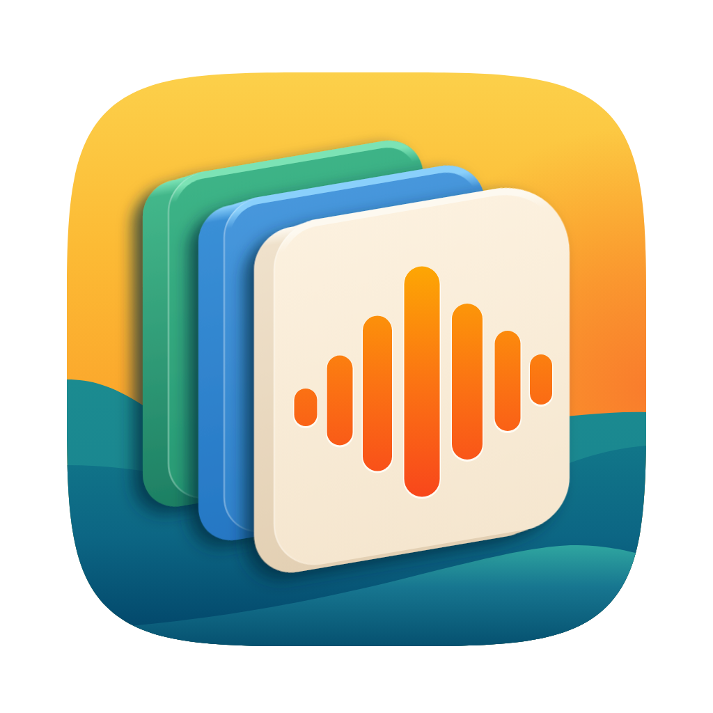
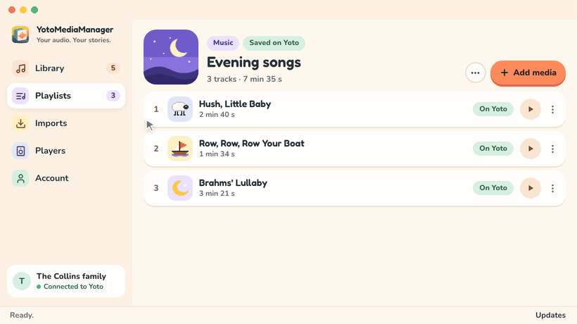

<div align="center">



<h1>YotoMediaManager</h1>

<p><strong>The songs they ask for. The stories in your language. All on their Yoto.</strong></p>

<p>
  A desktop app for parents with a Yoto at home: import audio from a file or a YouTube link,<br>
  keep just the right part, and add it to a playlist on your Yoto account. No command line, no audio editor.
</p>

<p>
  <a href="https://github.com/damione1/yoto-media-manager/releases"></a>
  <a href="https://github.com/damione1/yoto-media-manager/actions/workflows/ci.yml"></a>
  
  
  
  
</p>

<p>
  <a href="#download"><strong>Download</strong></a> ·
  <a href="#what-it-does">Features</a> ·
  <a href="site/src/docs/index.md">User guide</a> ·
  <a href="#build-from-source">Build from source</a>
</p>

</div>

<p align="center"></p>

## Why it exists

Yoto has a wonderful catalogue, with hundreds of stories, songs and adventures to discover. But my two-year-old had a much shorter wish list: a few favourite nursery rhymes, on repeat. The ones we loved were on YouTube, and I wanted to hear them coming from our Yoto.

Much of the content I found was in English or aimed at older children. Sometimes, what your family wants is a particular song, a familiar story in another language, or simply something that isn't in the catalogue.

Thankfully, Yoto lets families bring their own audio and provides an [API](https://yoto.dev/) for developers to build on. I'm grateful they left that door open. It made this app possible.

I built **YotoMediaManager** to bring the whole process into one place: find the audio, import it, trim away the intro or credits, and add it to a Yoto playlist. Less moving between tools. More time listening to the songs your little one actually wants.

## What it does

- **Import from a file or a YouTube link.** A single video or a whole public playlist, where you pick the videos to keep. Only the audio is kept, and titles are tidied up for you.
- **Keep just the right part.** Listen, drag the two handles to cut the intro or the credits, and the original stays untouched in your library.
- **Even volume.** Loud and quiet songs end up at a similar level, so nobody reaches for the volume button between tracks.
- **Playlists on your Yoto account.** Create them, reorder chapters and tracks, and changes are saved on their own. Audio that is too long for one Yoto track is split into parts for you.
- **Icons and covers.** Choose a Yoto pixel icon or import your own image, for a song in your library or straight in the playlist.
- **Your players.** See your Yoto players, control playback, and set them up from the app.
- **English and French.** The interface follows your choice and switches instantly.
- **Private by default.** Your library is stored encrypted on your computer and can be exported to move it to another one.

## Download

For **macOS** and **Windows**. Get the latest version from [Releases](https://github.com/damione1/yoto-media-manager/releases). The app checks for updates and installs them for you.

New to it? The [user guide](site/src/docs/index.md) walks through the first import, trimming, playlists and players.

## Build from source

You need the Rust toolchain pinned in `rust-toolchain.toml` and a Yoto developer client ID from [yoto.dev](https://yoto.dev/).

```sh
cp .env.example .env          # then set YOTO_CLIENT_ID
python3 scripts/prepare_tools.py --target aarch64-apple-darwin   # yt-dlp, deno, FFmpeg into tools/
YOTO_DEV_TOOLS=tools/aarch64-apple-darwin cargo run -p yoto-desktop
```

Use `x86_64-apple-darwin` on an Intel Mac and `x86_64-pc-windows-msvc` on Windows. On macOS the script builds FFmpeg from source, so the first run takes a while.

A build you make yourself shows the version **nightly** and never updates itself.

## Thanks

[Third-party notices](distribution/THIRD-PARTY-NOTICES.md)
