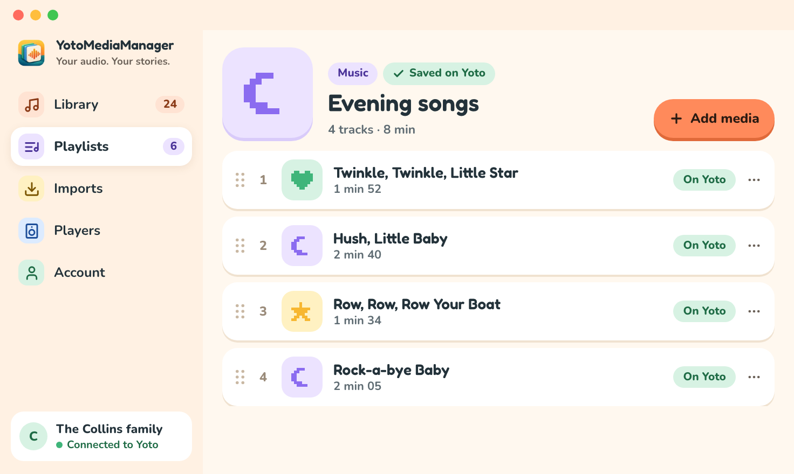

# Your first playlist

## Install the app

On macOS, open the installation disk and drag **YotoMediaManager** into **Applications**. On Windows, run the installer and follow its steps. Then open the app from Applications or the Start menu.

## Add your first audio file

1. Open `Library` and choose `Add an audio file`.
2. Select an audio file, such as an MP3.
3. Open `Imports` to follow its analysis. Once complete, the media appears in `Library`.
4. Choose `Listen` on that media.
5. To remove an introduction or credits, choose `Trim the audio`, adjust the two boundaries, and choose `Apply`.

The original is preserved. The prepared version is available alongside it.

## Build the playlist

1. Connect your account in `Account`. Your Yoto playlists load automatically.
2. Open `Playlists`, choose an existing playlist, or enter a title and choose `Create a playlist`.
3. Choose `Add media`, check the audio files and versions you want, and choose `Add (…)`.
4. Follow the upload. The tracks appear after Yoto confirms the update.
5. Rename chapters and choose their illustrations. Changes are sent directly to Yoto.

You can import and prepare audio without a Yoto account. Creating and editing playlists requires a connected account.

## Listen on your player

In `Players`, refresh your devices, select your player, and start the playlist. The [account and sync guide](account-and-sync.md) explains upload states and possible conflicts.
