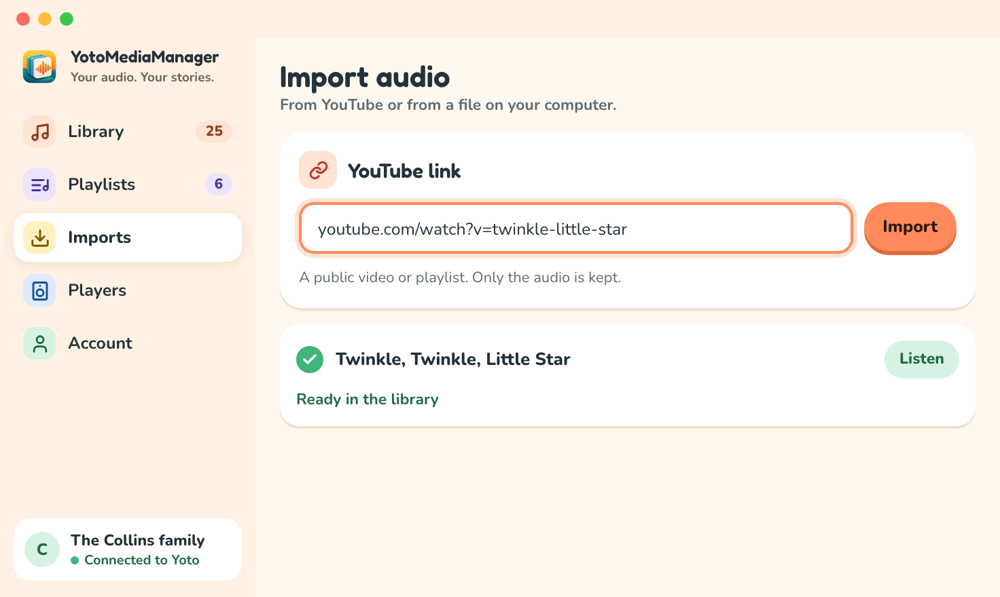

# Import media

## From an audio file

Choose `+ Ajouter un fichier` or `Ajouter un fichier audio`, then select one or more files. You can also drag audio files into the app.

The app copies and analyzes each file. Your source file stays in its original location, and the library keeps its own copy. You can rename imported media later.

## From YouTube

1. Open `Imports` and paste the video's address.
2. Choose `Importer`. A single video is downloaded directly.
3. Follow the download and analysis in the import history.

For a YouTube playlist, the app shows the available videos. Select the ones you want, then choose `Importer la sélection`. This selection is required even when the playlist contains just one video. The app limits this selection to 100 videos.

Downloading and extracting audio happen on your computer. Audio is sent to Yoto when you choose to add it to a playlist. Private videos, content requiring a login, and some restricted videos may be inaccessible.

## Follow tasks

The `Imports` screen shows progress and errors. A completed import displays the media title and lets you open it in the library. The original address is available in `Détails`. `Annuler` stops a running task; `Réessayer` is offered when a failed task can be retried.

An error with one link does not remove other media from your library. Check the link, public access to the video, and your connection, then see [troubleshooting](troubleshooting.md).

## Organize imported media

In `Médiathèque`, search for a title and open `Trier` to choose title (`Titre`), author (`Auteur`), duration (`Durée`), or recent imports (`Récents`). Use the checkboxes to select multiple media. The `⋯` menu next to `Ajouter un fichier audio` offers selection of all results, cache cleanup, and exporting or importing the whole library.

Local deletion is refused while a playlist still uses the media. Remove the relevant tracks first. The [export guide](backups.md) explains how to keep a copy of your library.
