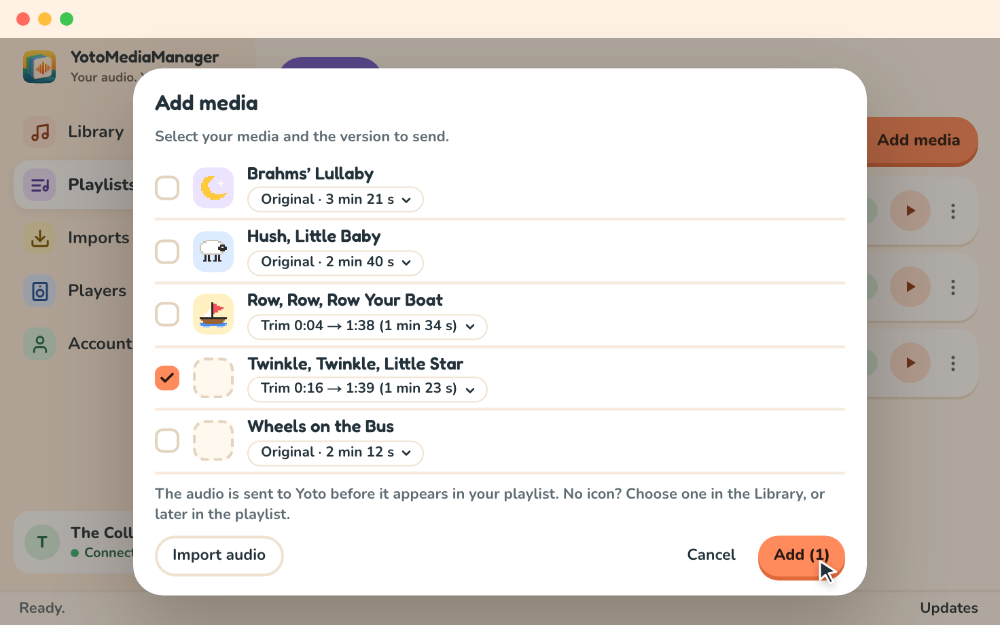
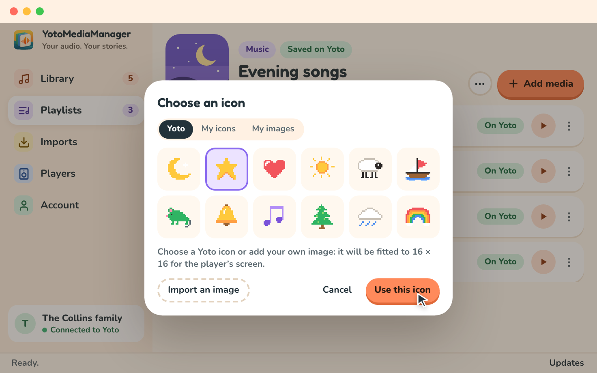

# Build a playlist

## Find your Yoto playlists

Connect your account in `Account`, then open `Playlists`. Your Make Your Own creations load automatically from Yoto at startup and after login. Click a title to open its current content.

The list represents your Yoto playlists. A cache keeps the latest loaded data available; audio files you prepare stay in the local library. `Refresh from Yoto` reloads changes made elsewhere.

## Add audio

1. Open your playlist and choose `Add media`.
2. In the dialog, check the audio files you want from your library.
3. Choose each file's version if you have prepared more than one.
4. Choose `Add (1)` (the number counts your selection) to send it to Yoto.
5. Wait for confirmation. The dialog stays open while the audio is sent, then closes, and the tracks appear in the playlist.

A media without an icon arrives with an empty icon slot; you can choose its icon right after (see below). `Import audio` opens the `Imports` screen so you can add a file or YouTube link to your library. Prepare that audio, then return to the playlist and select it. Importing into the library does not automatically add media to a playlist.

Versions already uploaded to the active account are reused. A new trim may require another upload. The original remains on your computer.

Yoto accepts tracks of up to one hour. Audio longer than 55 minutes, such as an audiobook, is cut automatically when you add it: it becomes one chapter with several tracks named “<title> — part 1 of 3”, “part 2 of 3”… of equal length. Each part is prepared separately so the cuts are clean, and parts already prepared or uploaded are reused when you add the same audio again. The audio's detail panel in `Library` tells you in advance how many parts it will become. Playlists stay limited to 100 tracks and 5 hours in total.

## Create and edit

Enter a title and choose `Create a playlist`. The playlist is created on Yoto, and the editor opens after confirmation, even if it has no audio yet.

Changes are saved to Yoto automatically; there is no save or publish button. Text is sent a moment after you stop typing, or as soon as you leave the field or press Enter. Several quick changes, such as moving a track up three times or changing a few icons, are grouped and sent together.

The tag next to the title shows `Saving…` while changes are on their way and `Saved on Yoto` once Yoto has them. You can keep editing meanwhile: what you change during a save is sent right after it. Changes still waiting are sent when you open another playlist or page and before the app quits. If they cannot be saved, a message names the playlist and explains why; when quitting, you can stay or choose `Quit anyway`.

If an error occurs, the message and task details explain what still needs attention.

## Choose illustrations

A cover represents the playlist. Small icons represent its chapters or tracks on the player.

Click a track's icon, or its empty slot marked `+`, or choose `Change the icon` in the track's `⋮` menu. The `Choose an icon` dialog offers the `Yoto` catalog, `My icons` (your icons on Yoto) and `My images` (pictures you imported before). Select an icon and choose `Use this icon`, or choose `Import an image` to use a picture of your own: it is fitted to 16 × 16 for the player's screen. The dialog closes and the change is saved to Yoto with your other changes.

An icon chosen for a media in `Library` comes with it into the playlists you add it to afterwards.

A song displays a single title. Playlists with chapters containing multiple tracks keep that structure; their detailed settings remain available in the menus.

## Organize chapters

By default each song you add is a chapter of its own and shows as one line, which is all most playlists need: the buttons on the player skip from one chapter to the next. You can also group several tracks into one chapter, for an album or a story told in several files, and give that chapter its own title and icon.

- **Group.** In a track's `⋮` menu, choose `Group with the track above` or `Group with the track below`. The chapter gets a header with its number, its icon and an editable title: name it there. A chapter's `⋮` menu offers `Merge with the previous chapter` and `Merge with the next chapter`.
- **Take apart.** In a track's `⋮` menu, `Take out of the chapter` makes it a chapter again, and `Split the chapter before this track` cuts the chapter in two. The chapter's menu keeps `Split the tracks into chapters`.
- **Drag and drop.** Every track and every chapter header has a grab handle (`⋮⋮`) on its left. Drag a track between two tracks to move it there, onto a chapter header to add it at the end of that chapter, or between two chapters to make it a chapter of its own; drag a chapter header to reorder chapters. A line shows where the item will land, and a chapter that will receive the track is highlighted.
- **Move dialog.** `Move / group…` lists every chapter with its number, title and number of tracks, lets you choose `At the start` or `At the end` of the chosen chapter, and offers `New chapter` to put the track in a chapter of its own at the end of the playlist.
- **Add into a chapter.** A chapter's `⋮` menu has `Add media to this chapter…`: the media you tick arrive at the end of that chapter instead of as new chapters.

A track that leaves a chapter keeps the icon it showed there, so nothing changes on the player. Every change is saved to Yoto like the others. A change that would alter a random playback range is refused with an explanation; remove the range in the playlist's options first.

## Choose playback behavior

Linear playback follows the chapters and tracks in order. End-of-track settings let playback continue to the next track, repeat, or stop.

Interactive playback, events, random playback ranges and streams are under the playlist's `Advanced settings`, shown only when `Advanced mode` is on in `Account`. Some order changes are blocked if they would make an event reference ambiguous. Update the affected events before continuing.

## Duplicate or delete

In the playlist’s `⋯` menu (`More actions`), duplication creates a new playlist on Yoto. Deleting a playlist removes it from your Yoto account and keeps your original audio in the library.

## Changes elsewhere or an uncertain upload

Opening or refreshing a playlist reads its content from Yoto again. If another app changed it during your operation, a conflict may require a choice. Your edits are preserved to let you resolve it.

If Yoto may have accepted an upload but its response did not arrive, open the task details in `Imports` and choose `Check with Yoto`. The app checks the result before allowing another upload, to avoid duplicates.
