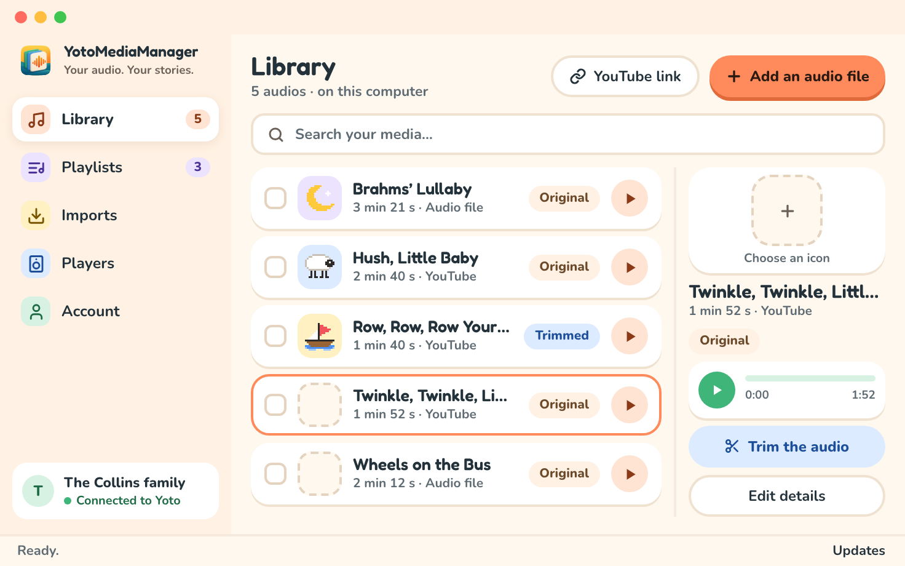
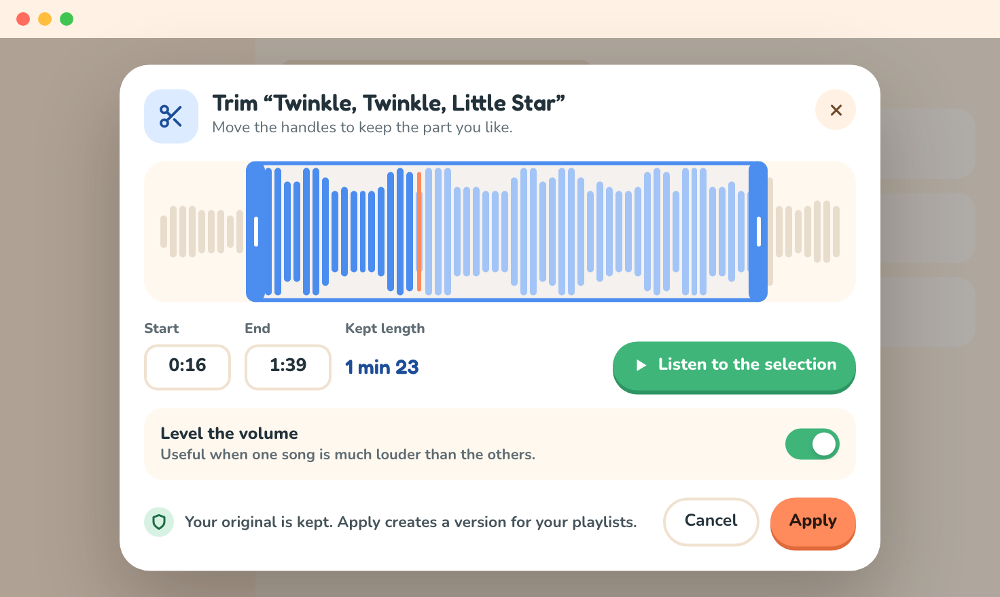

# Trim and preview audio for your Yoto playlists

Prepare the tracks you have [imported](imports.md) before adding them to a [Yoto playlist](playlists.md). Trimming keeps the original so you can choose a different cut later.

From `Library`, choose `Listen` on the media you want. The player shows its title and duration, a play button, and a slider for seeking. Editing tools are available when you need them.

## Remove an introduction or credits

1. Choose `Trim the audio` to open the trimming dialog and its waveform.
2. Drag the start and end handles on the waveform, or the slider under it, to keep the part you want.
3. For greater precision, enter the two positions in seconds. For example, start `12` and end `180` keep the audio from 12 seconds to 3 minutes.
4. Click the waveform to move the playhead, then choose `Listen to the selection` to listen from there. If you click the waveform while it is already playing, playback continues from the new spot.
5. Adjust the boundaries, then choose `Apply`. The app prepares an MP3 version; when it is ready, the dialog closes and the player shows `Trimmed version`.

Playback in the trimming dialog plays only the selected range. `Stop listening` stops the preview. `Cancel` or Escape closes the dialog without creating a version; your original stays intact.

The end must follow the start and stay within the original duration. The app reports an error if the boundaries are invalid.

## Mark chapters

An audiobook or a long recording can arrive in a playlist already cut into chapters, so the player's buttons skip from one to the next.

1. Choose `Mark chapters` under `Trim the audio`. The dialog shows the waveform of the whole original.
2. Listen, click the waveform to move the playhead to where a new part begins, then choose `Add a chapter here`. A mark appears on the waveform; drag it to adjust it, and the arrow keys move the playhead by a few seconds.
3. Each resulting chapter is listed with its start, end and length. Type a title for it, or leave the field empty to use “Part 1”, “Part 2”… `Listen` plays from the chapter's start; `Remove` deletes a mark.
4. Choose `Save`. The library row and the side panel then show how many chapters the audio has.

Marks are stored with the audio on your computer; the original stays intact. When you add the audio to a playlist, it arrives as one chapter titled like the audio and carrying its icon, holding one track per mark with the title you gave it: the playlist editor shows it grouped under its header, and the player's buttons skip from one track to the next. A mark longer than 55 minutes is also cut into parts. Marks live on the original: with a trimmed version, only the marks inside the kept range are used, and the dialog shades the kept range to show it. `Remove all chapters` goes back to a single track. Playlists that already hold the audio are not changed.

## Make volume more consistent

In the trimming dialog, enable `Level the volume` to prepare a version with more consistent volume. Leave this option off to preserve the source level.

Conversion and volume normalization happen on your computer. The dialog shows `Preparing your trim…` and closes when the version is available. You can also find this task in `Imports`.

## Understand audio versions

The original stays intact. Each preparation creates a reusable version. You can keep the full audio, a version without an introduction, and several excerpts from the same media.

When adding audio to a playlist, select the version you want. Creating a new version does not automatically replace tracks already added to a playlist.

## Rename and export

In the player's `⋯` menu, open the information editor. Change the title, author, and tags, then choose `Save`. Separate tags with commas.

The same menu lets you export the original or delete media that no playlist uses. Export writes a copy of your original audio file to the location you choose.
