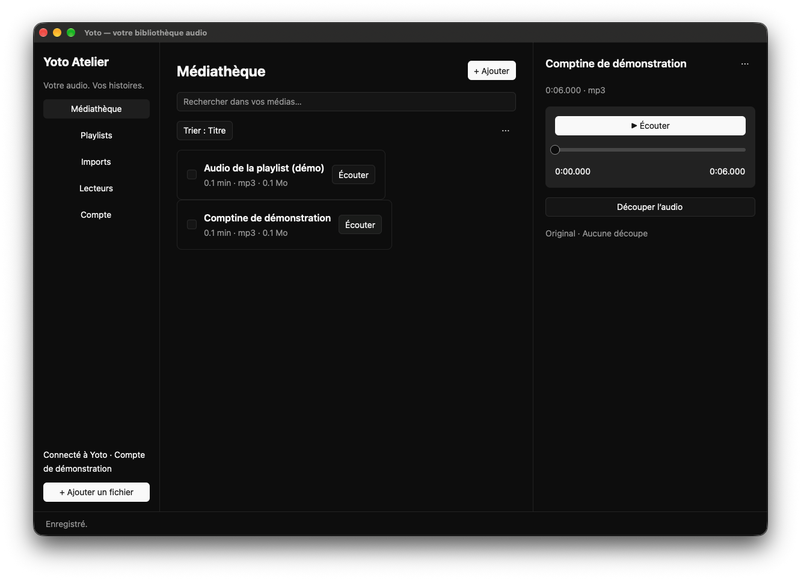
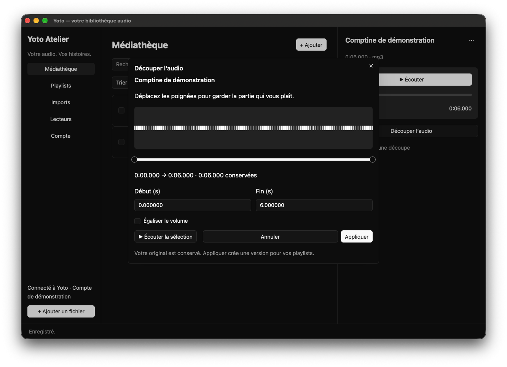

# Trim and listen

From `Médiathèque`, choose `Écouter` on the media you want. The player shows its title and duration, a play button, and a slider for seeking. Editing tools are available when you need them.

## Remove an introduction or credits

1. Choose `Découper l’audio` to open the trimming dialog and its waveform.
2. Drag the start and end boundaries to keep the part you want.
3. For greater precision, enter the two positions in seconds. For example, start `12` and end `180` keep the audio from 12 seconds to 3 minutes.
4. Choose `Écouter la sélection` to check your selection.
5. Adjust the boundaries, then choose `Appliquer`. The app prepares an MP3 version and returns to the player when it is ready.

Playback in the trimming dialog plays only the selected range. `Arrêter` stops the preview. `Annuler` or Escape closes the dialog without creating a version; your original stays intact.

The end must follow the start and stay within the original duration. The app reports an error if the boundaries are invalid.

## Make volume more consistent

In the trimming dialog, enable `Égaliser le volume` to prepare a version with more consistent volume. Leave this option off to preserve the source level.

Conversion and volume normalization happen on your computer. The dialog shows preparation progress and closes when the version is available. You can also find this task in `Imports`.

## Understand audio versions

The original stays intact. Each preparation creates a reusable version. You can keep the full audio, a version without an introduction, and several excerpts from the same media.

When adding audio to a playlist, select the version you want. Creating a new version does not automatically replace tracks already added to a playlist.

## Rename and export

In the player's `⋯` menu, open the information editor. Change the title, author, and tags, then choose `Enregistrer`. Separate tags with commas.

The same menu lets you export the original or delete media that no playlist uses. Export writes a copy of your original audio file to the location you choose.
