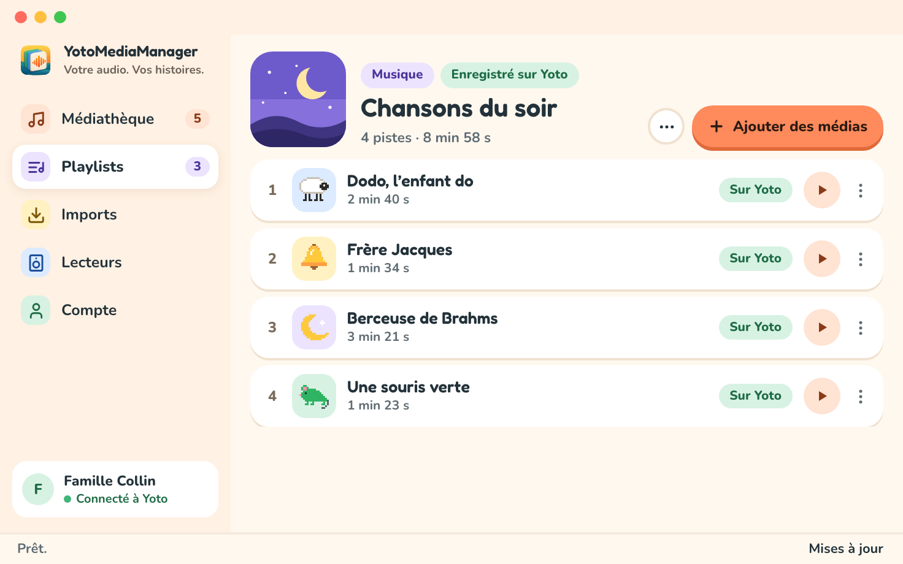

# Votre première playlist

## Installer l’application

Sur macOS, ouvrez le disque d’installation et glissez **YotoMediaManager** dans **Applications**. Sur Windows, lancez l’installateur et suivez ses étapes. Ouvrez ensuite l’application depuis Applications ou le menu Démarrer.

## Ajouter votre premier fichier audio

1. Ouvrez `Médiathèque` et choisissez `Ajouter un fichier audio`.
2. Sélectionnez un fichier audio, par exemple un MP3.
3. Ouvrez `Imports` pour suivre son analyse. Une fois terminée, le média apparaît dans `Médiathèque`.
4. Choisissez `Écouter` sur ce média.
5. Pour retirer une introduction ou un générique, choisissez `Découper l’audio`, ajustez les deux bornes et choisissez `Appliquer`.

L’original est conservé. La version préparée est disponible à côté.

## Construire la playlist

1. Connectez votre compte dans `Compte`. Vos playlists Yoto se chargent automatiquement.
2. Ouvrez `Playlists`, choisissez une playlist existante, ou saisissez un titre et choisissez `Créer une playlist`.
3. Choisissez `Ajouter des médias`, cochez les fichiers audio et les versions voulus, puis choisissez `Ajouter`.
4. Suivez l’envoi. Les pistes apparaissent quand Yoto a confirmé la mise à jour.
5. Renommez les chapitres et choisissez leurs illustrations. Les changements sont envoyés directement à Yoto.

Vous pouvez importer et préparer de l’audio sans compte Yoto. Créer et modifier des playlists demande un compte connecté.

## Écouter sur votre lecteur

Dans `Lecteurs`, actualisez vos appareils, choisissez votre lecteur et lancez la playlist. Le [guide du compte et de la synchronisation](account-and-sync.md) explique les états d’envoi et les conflits possibles.
