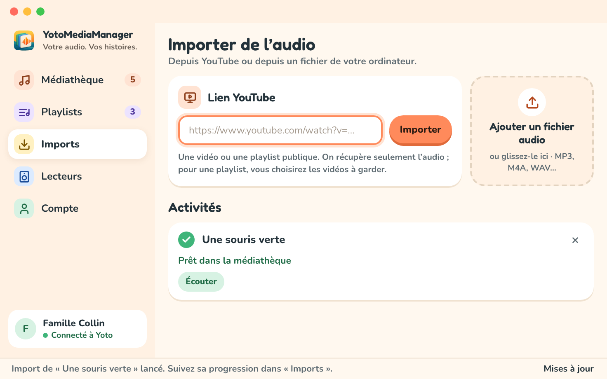

# Importer un MP3 ou YouTube pour Yoto

Ajoutez des fichiers audio, une vidéo ou une playlist YouTube publique à votre médiathèque locale. Vous pourrez ensuite [découper l’audio](prepare-audio.md) et [l’ajouter à une playlist Yoto](playlists.md).

## Depuis un fichier audio

Choisissez `+ Ajouter un fichier` ou `Ajouter un fichier audio`, puis sélectionnez un ou plusieurs fichiers. Vous pouvez aussi glisser des fichiers audio dans l’application.

L’application copie et analyse chaque fichier. Votre fichier source reste à son emplacement d’origine, et la médiathèque garde sa propre copie. Vous pourrez renommer les médias importés plus tard.

## Depuis YouTube

1. Ouvrez `Imports` et collez l’adresse de la vidéo.
2. Choisissez `Importer`. Une vidéo seule est téléchargée directement.
3. Suivez le téléchargement et l’analyse dans l’historique des imports.

Pour une playlist YouTube, l’application affiche les vidéos disponibles. Sélectionnez celles que vous voulez, puis choisissez `Importer la sélection`. Cette sélection est demandée même quand la playlist ne contient qu’une vidéo. L’application limite la sélection à 100 vidéos.

Le téléchargement et l’extraction de l’audio se font sur votre ordinateur. L’audio est envoyé à Yoto quand vous choisissez de l’ajouter à une playlist. Les vidéos privées, les contenus qui demandent une connexion et certaines vidéos restreintes peuvent être inaccessibles.

## Suivre les tâches

L’écran `Imports` montre la progression et les erreurs. Un import terminé affiche le titre du média et permet de l’ouvrir dans la médiathèque. L’adresse d’origine est disponible dans `Détails`. `Annuler` arrête une tâche en cours ; `Réessayer` est proposé quand une tâche échouée peut être relancée.

Une erreur sur un lien ne retire aucun autre média de votre médiathèque. Vérifiez le lien, l’accès public à la vidéo et votre connexion, puis consultez le [dépannage](troubleshooting.md).

## Ranger les médias importés

Dans `Médiathèque`, cherchez un titre et ouvrez `Trier` pour trier par titre (`Titre`), auteur (`Auteur`), durée (`Durée`) ou imports récents (`Récents`). Utilisez les cases à cocher pour sélectionner plusieurs médias. Le menu `⋯` à côté de `Ajouter un fichier audio` permet de sélectionner tous les résultats, de nettoyer le cache, et d’exporter ou d’importer toute la médiathèque.

La suppression locale est refusée tant qu’une playlist utilise encore le média. Retirez d’abord les pistes concernées. Le [guide d’export](backups.md) explique comment garder une copie de votre médiathèque.
