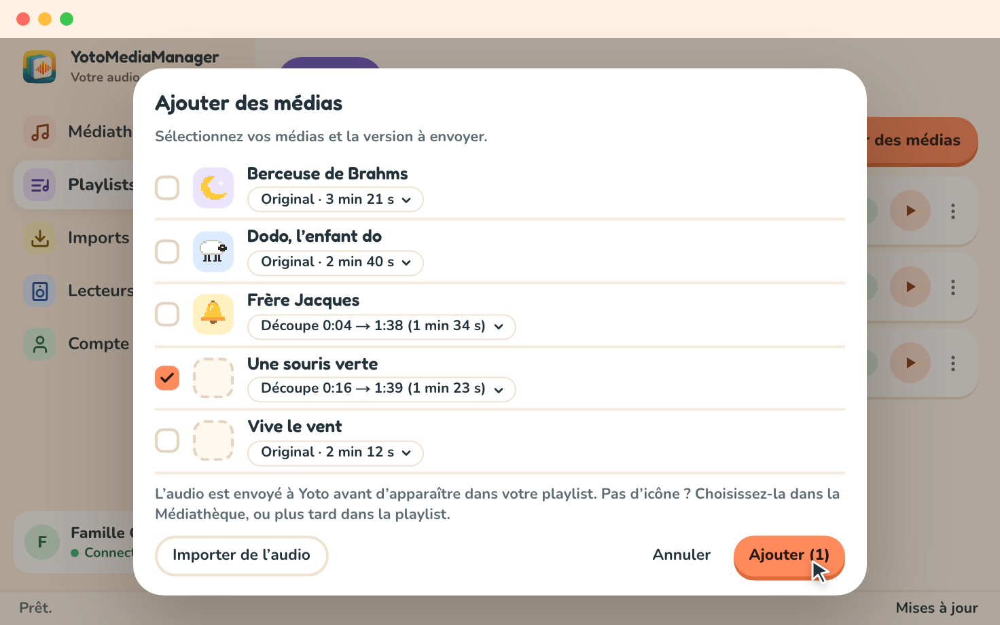
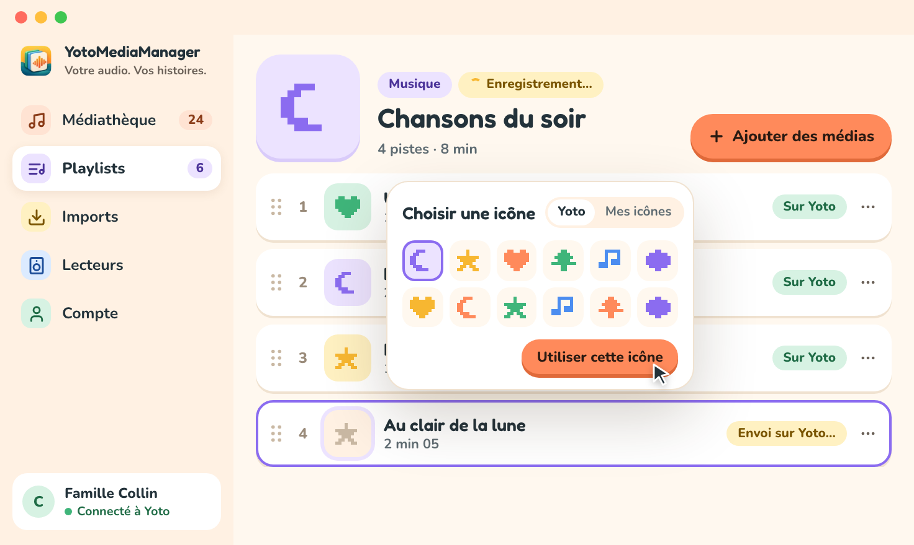

# Construire une playlist

## Retrouver vos playlists Yoto

Connectez votre compte dans `Compte`, puis ouvrez `Playlists`. Vos créations « Make Your Own » se chargent automatiquement depuis Yoto au démarrage et après la connexion. Cliquez sur un titre pour ouvrir son contenu actuel.

La liste représente vos playlists Yoto. Un cache garde disponibles les dernières données chargées ; les fichiers audio que vous préparez restent dans la médiathèque locale. `Actualiser depuis Yoto` recharge les changements faits ailleurs.

## Ajouter de l’audio

1. Ouvrez votre playlist et choisissez `Ajouter des médias`.
2. Dans le dialogue, cochez les fichiers audio voulus dans votre médiathèque.
3. Choisissez la version de chaque fichier si vous en avez préparé plusieurs.
4. Choisissez `Ajouter (1)` (le nombre compte votre sélection) pour l’envoyer à Yoto.
5. Attendez la confirmation. Le dialogue reste ouvert pendant l’envoi de l’audio, puis se ferme, et les pistes apparaissent dans la playlist.

Un média sans icône arrive avec un emplacement d’icône vide ; vous pouvez choisir son icône juste après (voir plus bas). `Importer de l’audio` ouvre l’écran `Imports` pour ajouter un fichier ou un lien YouTube à votre médiathèque. Préparez cet audio, puis revenez à la playlist et sélectionnez-le. Importer dans la médiathèque n’ajoute pas automatiquement le média à une playlist.

Les versions déjà envoyées sur le compte actif sont réutilisées. Une nouvelle découpe peut demander un nouvel envoi. L’original reste sur votre ordinateur.

Yoto accepte des pistes d’une heure au plus. Un audio de plus de 55 minutes, comme un livre audio, est découpé automatiquement quand vous l’ajoutez : il devient un chapitre de plusieurs pistes de même longueur, nommées « <titre> — partie 1/3 », « partie 2/3 »… Chaque partie est préparée séparément pour que les coupes soient nettes, et les parties déjà préparées ou envoyées sont réutilisées quand vous ajoutez de nouveau le même audio. Le panneau de détail de l’audio dans `Médiathèque` indique à l’avance en combien de parties il sera découpé. Les playlists restent limitées à 100 pistes et 5 heures au total.

## Créer et modifier

Saisissez un titre et choisissez `Créer une playlist`. La playlist est créée sur Yoto, et l’éditeur s’ouvre après confirmation, même si elle ne contient pas encore d’audio.

Les changements sont enregistrés sur Yoto automatiquement ; il n’y a pas de bouton pour enregistrer ou publier. Le texte est envoyé un instant après que vous avez fini de taper, ou dès que vous quittez le champ ou appuyez sur Entrée. Plusieurs changements rapides, comme monter une piste trois fois ou changer quelques icônes, sont regroupés et envoyés ensemble.

L’étiquette à côté du titre affiche `Enregistrement…` pendant l’envoi des changements et `Enregistré sur Yoto` une fois que Yoto les a reçus. Vous pouvez continuer à modifier pendant ce temps : ce que vous changez pendant un enregistrement est envoyé juste après. Les changements encore en attente sont envoyés quand vous ouvrez une autre playlist ou une autre page, et avant que l’application se ferme. S’ils ne peuvent pas être enregistrés, un message nomme la playlist et explique pourquoi ; en quittant, vous pouvez rester ou choisir `Quitter quand même`.

En cas d’erreur, le message et le détail de la tâche expliquent ce qui demande encore votre attention.

## Choisir les illustrations

Une couverture représente la playlist. De petites icônes représentent ses chapitres ou ses pistes sur le lecteur.

Cliquez sur l’icône d’une piste, ou sur son emplacement vide marqué `+`, ou choisissez `Changer l’icône` dans le menu `⋮` de la piste. Le dialogue `Choisir une icône` propose le catalogue `Yoto`, `Mes icônes` (vos icônes sur Yoto) et `Mes images` (les images que vous avez déjà importées). Sélectionnez une icône et choisissez `Utiliser cette icône`, ou choisissez `Importer une image` pour utiliser votre propre image : elle est adaptée en 16 × 16 pour l’écran du lecteur. Le dialogue se ferme et le changement est enregistré sur Yoto avec vos autres changements.

Une icône choisie pour un média dans `Médiathèque` l’accompagne dans les playlists où vous l’ajoutez ensuite.

Une chanson affiche un seul titre. Les playlists dont les chapitres contiennent plusieurs pistes gardent cette structure ; leurs réglages détaillés restent disponibles dans les menus.

## Choisir le mode de lecture

La lecture linéaire suit les chapitres et les pistes dans l’ordre. Les réglages de fin de piste permettent de passer à la piste suivante, de répéter ou de s’arrêter.

La lecture interactive, les événements, les plages de lecture aléatoire et les flux se trouvent dans les `Réglages avancés` de la playlist, affichés seulement quand le `Mode avancé` est activé dans `Compte`. Certains changements d’ordre sont bloqués s’ils rendaient ambiguë la référence d’un événement. Mettez à jour les événements concernés avant de continuer.

## Dupliquer ou supprimer

Dans `Plus`, la duplication crée une nouvelle playlist sur Yoto. Supprimer une playlist la retire de votre compte Yoto et garde votre audio original dans la médiathèque.

## Changements faits ailleurs ou envoi incertain

Ouvrir ou actualiser une playlist relit son contenu sur Yoto. Si une autre application l’a modifiée pendant votre opération, un conflit peut demander un choix. Vos modifications sont conservées pour vous permettre de le résoudre.

Si Yoto a peut-être accepté un envoi sans que sa réponse arrive, ouvrez le détail de la tâche dans `Imports` et choisissez `Vérifier auprès de Yoto`. L’application vérifie le résultat avant d’autoriser un nouvel envoi, pour éviter les doublons.
