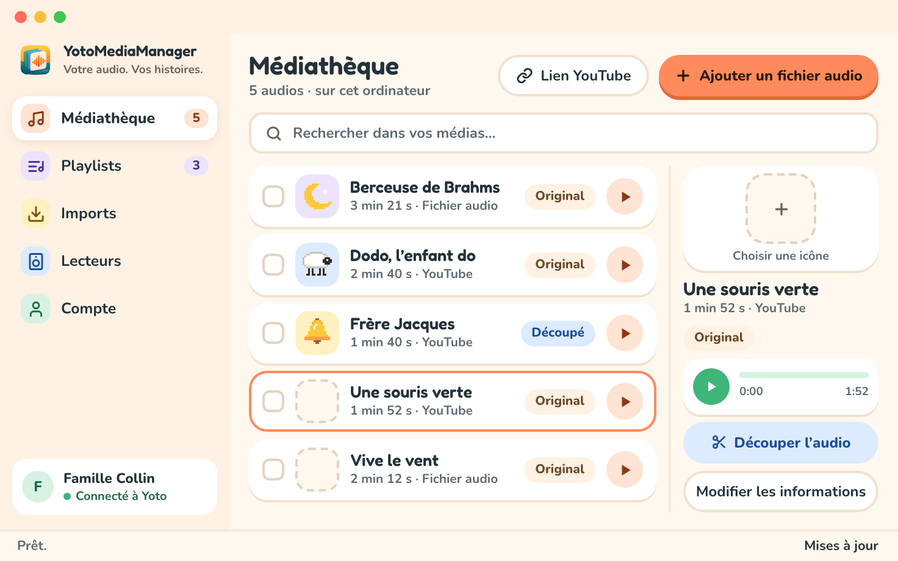
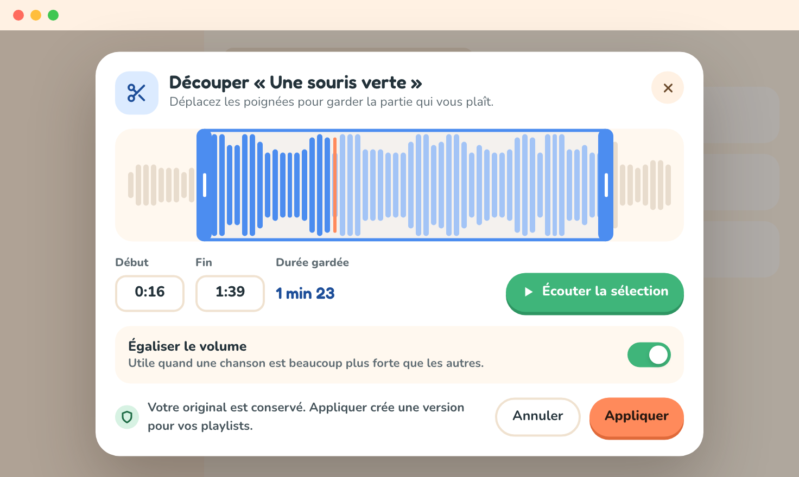

# Découper et écouter un audio pour Yoto

Préparez les pistes que vous avez [importées](imports.md) avant de les ajouter à une [playlist Yoto](playlists.md). La découpe conserve l’original pour vous permettre de choisir un autre passage plus tard.

Dans `Médiathèque`, choisissez `Écouter` sur le média voulu. Le lecteur affiche son titre et sa durée, un bouton de lecture et un curseur pour se déplacer. Les outils de modification sont là quand vous en avez besoin.

## Retirer une introduction ou un générique

1. Choisissez `Découper l’audio` pour ouvrir le dialogue de découpe et sa forme d’onde.
2. Faites glisser les poignées de début et de fin sur la forme d’onde, ou le curseur en dessous, pour garder la partie voulue.
3. Pour plus de précision, saisissez les deux positions en secondes. Par exemple, début `12` et fin `180` gardent l’audio de 12 secondes à 3 minutes.
4. Cliquez sur la forme d’onde pour déplacer la tête de lecture, puis choisissez `Écouter la sélection` pour écouter à partir de là. Si vous cliquez sur la forme d’onde pendant l’écoute, la lecture continue à partir du nouvel endroit.
5. Ajustez les bornes, puis choisissez `Appliquer`. L’application prépare une version MP3 ; quand elle est prête, le dialogue se ferme et le lecteur affiche `Version découpée`.

Dans le dialogue de découpe, la lecture ne joue que la plage sélectionnée. `Arrêter l’écoute` arrête l’écoute. `Annuler` ou la touche Échap ferme le dialogue sans créer de version ; votre original reste intact.

La fin doit suivre le début et rester dans la durée de l’original. L’application signale une erreur si les bornes ne sont pas valides.

## Marquer des chapitres

Un livre audio ou un long enregistrement peut arriver dans une playlist déjà découpé en chapitres, pour que les boutons du lecteur passent de l’un à l’autre.

1. Choisissez `Marquer des chapitres` sous `Découper l’audio`. Le dialogue montre la forme d’onde de tout l’original.
2. Écoutez, cliquez sur la forme d’onde pour placer la tête de lecture là où une nouvelle partie commence, puis choisissez `Ajouter un chapitre ici`. Un repère apparaît sur la forme d’onde ; faites-le glisser pour l’ajuster, et les flèches du clavier déplacent la tête de lecture de quelques secondes.
3. Chaque chapitre obtenu est listé avec son début, sa fin et sa durée. Saisissez-lui un titre, ou laissez le champ vide pour obtenir « Partie 1 », « Partie 2 »… `Écouter` joue depuis le début du chapitre ; `Retirer` supprime un repère.
4. Choisissez `Enregistrer`. La ligne de la médiathèque et le panneau latéral indiquent alors combien de chapitres l’audio contient.

Les repères sont enregistrés avec l’audio sur votre ordinateur ; l’original reste intact. Quand vous ajoutez l’audio à une playlist, il arrive en un seul chapitre, nommé comme l’audio et portant son icône, avec une piste par repère au titre que vous lui avez donné : l’éditeur de playlist le montre regroupé sous son en-tête, et les boutons du lecteur passent d’une piste à la suivante. Un repère de plus de 55 minutes est aussi découpé en parties. Les repères vivent sur l’original : avec une version découpée, seuls les repères à l’intérieur de la plage gardée sont utilisés, et le dialogue grise le reste pour le montrer. `Retirer tous les chapitres` revient à une seule piste. Les playlists qui contiennent déjà l’audio ne sont pas modifiées.

## Rendre le volume plus régulier

Dans le dialogue de découpe, activez `Égaliser le volume` pour préparer une version au volume plus régulier. Laissez cette option désactivée pour garder le niveau de la source.

La conversion et l’égalisation du volume se font sur votre ordinateur. Le dialogue affiche `Préparation de votre découpe…` et se ferme quand la version est disponible. Vous retrouvez aussi cette tâche dans `Imports`.

## Comprendre les versions audio

L’original reste intact. Chaque préparation crée une version réutilisable. Vous pouvez garder l’audio complet, une version sans introduction et plusieurs extraits du même média.

Quand vous ajoutez de l’audio à une playlist, choisissez la version voulue. Créer une nouvelle version ne remplace pas automatiquement les pistes déjà ajoutées à une playlist.

## Renommer et exporter

Dans le menu `⋯` du lecteur, ouvrez l’éditeur d’informations. Modifiez le titre, l’auteur et les étiquettes, puis choisissez `Enregistrer`. Séparez les étiquettes par des virgules.

Le même menu permet d’exporter l’original ou de supprimer un média qu’aucune playlist n’utilise. L’export écrit une copie de votre fichier audio original à l’endroit que vous choisissez.
